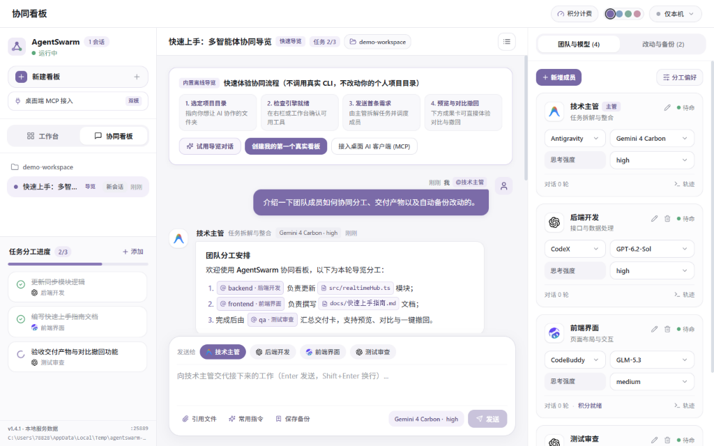
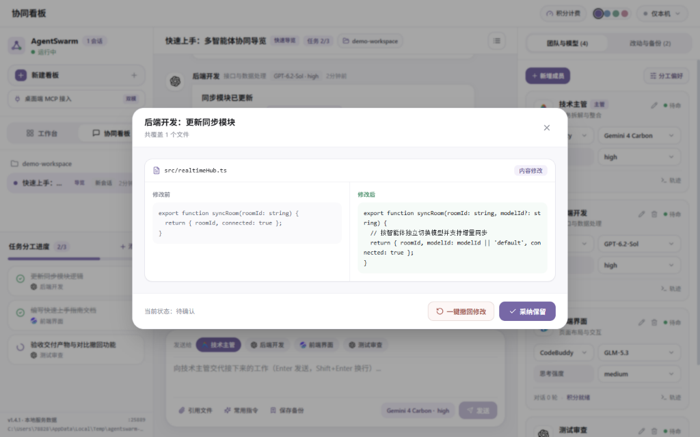

# AgentSwarm

**AgentSwarm** 是一款本地优先（Local-First）的多智能体群聊式协同看板、桌面端 MCP 主管调度中枢与额度工作台（Windows 桌面应用 + 局域网/手机协同界面）。

> **一句话看懂它能做什么**：把分散在终端或桌面窗口里的多个 AI 编程助手（Antigravity、CodeX、CodeBuddy、Claude Code 等）收拢到同一个群聊看板里协作分工，自动在改动前备份代码并支持分栏 Diff 预览与防冲突撤回。

<p>
  <a href="https://github.com/Huanzhi0526/AgentSwarm/releases/latest"><strong>⬇️ 下载 Windows x64 最新安装包 (Releases)</strong></a> ·
  <a href="./docs/USAGE_GUIDE.md"><strong>📖 完整新手教程与注意事项</strong></a> ·
  <a href="https://github.com/Huanzhi0526/AgentSwarm/issues"><strong>🐛 问题反馈 (Issues)</strong></a> ·
  <a href="./SECURITY.md"><strong>🛡️ 安全政策</strong></a>
</p>

---

## 下载选择、系统要求与安装信任说明

### 1. 安装包选择
| 资产类型 | 适用人群与说明 |
| :--- | :--- |
| **`*_x64-setup.exe`（普通用户首选）** | 简体中文安装向导（NSIS），默认安装到当前用户目录，无需管理员权限，支持托盘常驻与直接升级覆盖 |
| **`*_x64_en-US.msi`** | 标准 Windows Installer 企业/系统部署包（安装向导语言为英文 `en-US`） |
| **Source code (zip / tar.gz)** | 开发者源码包（需自行安装 Node.js 24+ 与 pnpm） |

### 2. 运行环境与前提条件
- **系统支持**：Windows 10 / Windows 11（64 位 `x64`），依赖系统自带 Microsoft Edge WebView2 运行时。
- **开箱即用底座**：Windows 安装包已内置 **Node.js 24 运行时**与打包后的全栈服务，安装完双击即可启动并浏览内置离线导览，无需手动安装 Node 或配置环境。
- **执行真实 AI 任务前提**：AgentSwarm 本身**不包含**云端模型额度；若要运行真实项目任务，本机需至少安装并登录一款受支持的 AI CLI 工具（如 `agy`、`codex`、`codebuddy`、`claude`）或已接入支持的桌面 AI 客户端。

### 3. 安装包签名状态与 SHA-256 校验（必读）
- **未签名提示**：目前开源社区版安装程序 **未购买商业 Authenticode 数字签名（`NotSigned`）**。首次下载运行 `.exe` 时若出现「Windows 已保护你的电脑（Microsoft Defender SmartScreen）」提示，请点击 **「更多信息」→「仍要运行」**。
- **校验文件完整性**：下载完成后，请在 Release 页面核对资产旁的 **SHA-256 摘要**，也可在 PowerShell 中运行以下命令比对一致再安装：
  ```powershell
  Get-FileHash .\AgentSwarm_1.4.1_x64-setup.exe -Algorithm SHA256
  ```

---

## 3 分钟快速上手：从安装到第一次成功交付

### 第 0 步：启动程序并体验离线导览
安装完成后启动桌面应用（关闭主窗口默认保留在右下角系统托盘，右键托盘图标可点击「在浏览器中打开」或「退出程序」）。首次启动新库会直接进入 **「快速上手：多智能体协同导览」**（离线演示，不调用真实 CLI，也不会修改你的个人项目目录）：



接下来，你可以根据习惯选择下面 **两条真实使用路线之一**（两者互不冲突，可随时结合）：

### 路线 A：直接在看板里给本地 CLI 团队派工（无需打开外部桌面客户端）
1. 在导览卡点击 **「创建我的第一个真实看板」**（或左上角 `+ 新建看板`）。
2. **第 1 步选定项目目录**：点击 **「在「文档」新建练习文件夹」** 或浏览选中你的代码/文稿目录（软件会拦截磁盘根目录、系统目录和程序自身安装目录以策安全）。
3. **第 2 步确认主管引擎可用**：模板卡片旁会直观显示 `已就绪` 或 `未安装`；也可展开团队配置自由增删成员、切换主管、调整引擎/模型与原生思考强度。
4. **第 3 步发送首条需求并验收交付**：主管收到消息后拆解任务并按依赖逐波次派给队员，文件产出后可在群聊中点击 **「预览」** 或 **「对比改动」** 逐行对比修改前后差异：



### 路线 B：让 Antigravity / CodeX / CodeBuddy / Claude Code 直接担任主管
1. 安装完 **AgentSwarm** 后，点击左侧栏或工作台中的 **「桌面端 MCP 接入」**。
2. 在支持客户端（**Antigravity / CodeX / CodeBuddy / Claude Code**）旁点击 **「一键接入」**（工具会自动先为原有配置文件创建 `.bak-cowork` 备份，且保留你的第三方配置与注释；随后点击弹窗右上角 **「一键自检」** 核对本地服务与脚本）。
3. **回到你的桌面 AI 客户端刷新 MCP 或新开对话**：围绕你的项目目录发话并调用 `cowork_setup_board` / `cowork_dispatch_wave` 创建协同团队，即可一边在桌面软件与主管交互，一边在 AgentSwarm 看板中可视化查看成员状态、任务进度与改动快照。

---

## 能力说明与使用注意事项（诚实边界）

### 1. 支持的桌面端 MCP 接入与 CLI 工具
- **已完成真机与流程验证的主力桌面端**：**Antigravity**（支持专属右侧栏 `MCP App` 视图、`app.sendMessage()` 侧栏直通与可独立启停的 `PreInvocation` Hook）、**CodeX**（自动写入 `tool_timeout_sec = 3600` 支撑长待命监听）、**CodeBuddy**、**Claude Code**。
- **20 款 CLI 智能体注册目录**：工作台参照 `iOfficeAI/AionUi` 收录 20 款 CLI（Antigravity、CodeX、CodeBuddy、Claude Code、Gemini CLI、Qwen Code、OpenCode、Cursor、Copilot CLI、Kimi CLI、Auggie、Goose、Droid、Qoder、Mistral Vibe、Kiro、Hermes、Snow、OpenClaw、Nanobot）。真实派工前请确保对应 CLI 在本机**已安装且已完成账号登录 / API 密钥配置**；若建板时所选主管尚未安装，首条消息会自动安全保留在输入框草稿中待切换后发送。
- **「自动监听」与「闲置唤醒」说明**：
  - 在「自动监听：开」下，支持长阻塞工具调用的宿主（如 CodeX、Claude Code 等）会在工具返回指引后调用 `cowork_wait_board(waitForNewActivity=true)` 挂起等待，期间不主动发请求空耗主管上下文（取决于宿主客户端自身的工具超时上限；顶部随时可点击「自动监听：关」或留言「结束监听」即时释放）。
  - Antigravity 打开右侧看板分栏且开启自动转接时，网页/手机留言可自动送入左侧对话；关闭侧栏时如开启了 Hook，可在你下次在 Antigravity 发话前附加未读留言；若桌面端完全闲置不响应，点击看板上的 **「本轮改由后台 CLI 主管立即代答」** 即可即时接管。

### 2. 安全、网络与多设备连接
- **默认仅限本机访问**：AgentSwarm 启动默认只绑定 `127.0.0.1`，局域网其他设备无法探测或接入。
- **手机扫码使用条件**：在电脑端右上角点击 **「仅本机」→ 开启「允许手机 / 其他设备访问」** 后才会绑定选定的局域网或异地组网 IP，手机需在同一路由器 Wi-Fi（且路由器未开启 AP 隔离）或登录同一 Tailscale/ZeroTier 组网，并通过扫码或输入 **4 位连接码** 配对（支持按单个设备移除或全部撤销）。
- **严禁公网裸奔暴露**：请勿将 `25880` 端口映射到公网或暴露在不可信公共 Wi-Fi 下。

### 3. 数据存储、多实例端口隔离与升级 / 卸载
- **数据存储位置**：
  - **Windows 安装版**：数据持久化在 `%LOCALAPPDATA%\AgentSwarm\data`（含数据库 `cowork-board.db`、文件快照 `snapshots/` 与日志 `desktop-server.*.log`）。
  - **源码开发运行**：数据默认保存在仓库根目录下的 `./data/`。
  - **多开与端口隔离**：若系统 25880 端口已被另一实例（例如源码开发环境）或其它软件占用，桌面端启动时会自动校验数据目录身份，并在独立端口（25881+）开启自身隔离实例，提供清晰选择避免误连旧数据。
- **原位升级、备份与卸载**：
  - 安装新版安装包原位覆盖或通过系统卸载程序移除软件本身，**不会删除 `%LOCALAPPDATA%\AgentSwarm\data` 中的历史数据**。
  - 重大版本升级或迁移前，可直接复制备份 `%LOCALAPPDATA%\AgentSwarm\data` 文件夹以保留全部看板与备份点。

👉 更多图文步骤、三向冲突撤回详解与常见排查，请阅读 **[完整用户手册：docs/USAGE_GUIDE.md](./docs/USAGE_GUIDE.md)**。

---

## 源码运行与二次开发

环境要求：**Node.js 24+**、**pnpm 11+**；打包 Windows 安装包另需 **Rust Stable** 与 Windows MSVC 构建工具（`.github/workflows/release.yml` 已配置自动构建、安装烟雾测试与 Release 发布）。

```bash
# 1. 安装依赖
pnpm install

# 2. 开发模式（Web http://127.0.0.1:5173 + Server http://127.0.0.1:25880）
pnpm dev

# 3. 类型检查与全量构建（输出 dist/、dist-server/、dist-mcp/）
pnpm build

# 4. 运行 11 项全隔离自动化审计（不触碰正式 data/）
pnpm exec tsx scripts/mcp_bridge_audit.mjs

# 5. 整理自包含运行时并打包 Tauri v2 安装程序
pnpm tauri:prepare
pnpm tauri build
```

更多工程架构与交接信息请参阅 [AGENTS.md](./AGENTS.md)、[PLAN.md](./PLAN.md) 与 [HANDOFF.md](./HANDOFF.md)。

---

## 开源致谢与许可证

本项目架构与功能演进参考了 `iOfficeAI/AionUi`、`claudioed/agent-blackboard`、`JialaoLiu/dsh-baton`、`jazzenchen/agent-hud-open`、`ccusage`、`@modelcontextprotocol/sdk`、`@modelcontextprotocol/ext-apps` 与 `Tauri` 等优秀开源项目。

基于 [MIT License](./LICENSE) 开源发布。欢迎在 [GitHub Issues](https://github.com/Huanzhi0526/AgentSwarm/issues) 提出建议与问题，或通过 [SECURITY.md](./SECURITY.md) 私密报告安全问题。
